### 🚀 **4+ años creando soluciones web completas**

Me apasiona construir aplicaciones que resuelvan problemas reales. Desde el frontend hasta la base de datos, me encargo de todo el stack.

## 🛰️ Tech Stack

## 🪐 Proyectos Destacados

<table>
<tr>
<td width="50%">

`PLANETA-01`
### 💰 FAMEAT POS
**Sistema de Punto de Venta completo**

Sistema POS para carnicerías y restaurantes con balanza digital integrada. PWA instalable en cualquier dispositivo.

**Stack:** `React` `Node.js` `PostgreSQL` `Prisma` `TypeScript`

</td>
<td width="50%">

`PLANETA-02`
### 🎨 Portfolio 3D
**Portafolio interactivo con Three.js**

Experiencia web inmersiva con modelos 3D, animaciones y diseño moderno.

**Stack:** `React 19` `Three.js` `Vite`

</td>
</tr>
<tr>
<td width="50%">

`PLANETA-03`
### 📊 Income Tracker
**Sistema de gestión financiera**

Aplicación para rastrear ingresos y gastos con visualización de datos y reportes.

**Stack:** `TypeScript` `React` `Node.js`

</td>
<td width="50%">

`PLANETA-04`
### ✅ Task Manager
**App MERN completa con autenticación**

Gestor de tareas con JWT, roles de usuario y persistencia en MongoDB.

**Stack:** `React` `Node.js` `MongoDB` `Express`

</td>
</tr>
</table>

## 📡 Telemetría

## 🌌 Galaxia de Contribuciones

## 👨‍🚀 Lo que me define

- 🔥 **Proactivo**: Siempre buscando nuevas formas de mejorar
- 🎯 **Enfocado en resultados**: Cada línea de código tiene un propósito
- 🌱 **Aprendiz continuo**: Explorando nuevas tecnologías cada día
- 🤝 **Colaborador**: Trabajo mejor en equipo
- 💪 **Resiliente**: Los bugs son oportunidades de aprendizaje

## 📫 Abrir canal de comunicación

**✨ Actualmente buscando nuevas oportunidades. ¡Hablemos! ✨**

